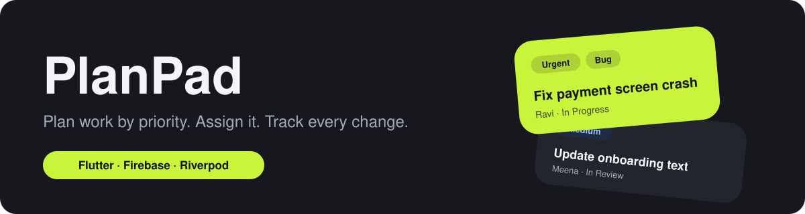

<p align="center">
  
</p>

<p align="center">
  
  
  
  
</p>

# PlanPad

PlanPad is a small task manager for teams. People have roles, work is grouped into projects, every task has a priority, and every status change is recorded with who made it. The app keeps working without internet and syncs when the connection comes back.

## Contents

- [Features](#features)
- [Roles](#roles)
- [Screens](#screens)
- [Tech stack](#tech-stack)
- [How the app is built](#how-the-app-is-built)
- [Data model](#data-model)
- [Getting started](#getting-started)
- [Seed data](#seed-data)
- [Admin web page](#admin-web-page)
- [Offline behaviour](#offline-behaviour)
- [Design](#design)
- [Known limitations](#known-limitations)

## Features

- Multiple users with different roles (Admin, Manager, Member)
- Projects with their own team, where each member has a project role: Manager, Dev or Test
- Tasks and bugs, each with a priority: Urgent, High, Medium or Low
- Assign a task to a project member, with each person's open task count shown while choosing
- Status flow: To Do, In Progress, In Review, Blocked, Done, Cancelled
- Status history on every task: the change, the person who made it and the time
- Search, filter (All, Urgent, Bugs, Tasks) and sort (priority, due date, title)
- Home dashboard with counts by status and priority, overdue tasks and weekly progress
- Works offline, with a "Pending sync" marker on changes that have not reached the server
- Profile page with change password and log out
- Separate admin web page to manage all users and projects

## Roles

There are two kinds of roles, and they are not the same thing.

| App role | Can do |
|---|---|
| **Admin** | Everything: manage users and roles, see every project and task |
| **Manager** | Create projects and tasks, manage project teams, assign work, see the Projects tab |
| **Member** | See the tasks of the projects they belong to and change the status of tasks assigned to them |

| Project role | Meaning |
|---|---|
| **Manager** | Runs the project |
| **Dev** | Builds the work |
| **Test** | Checks the work |

Project roles are labels inside one project. The app role decides what a person can do in the app.

## Screens

| Screen | What it does |
|---|---|
| Splash, Login, Success | Start-up animation, email and password sign-in, password reset |
| Home | Dashboard with counts and weekly progress |
| Tasks | Priority-sorted list with search, filters and sort |
| Add Task | Project, assignee, type, priority and due date |
| Task Details | Task information, change status, status history |
| Projects (managers) | Each project with its team and top pending tasks |
| Project Details | Team, pending and completed tasks, manage members |
| Add Project | Name, description and team members with roles |
| Profile | Account details, change password, log out |

## Tech stack

| Area | Choice |
|---|---|
| App | Flutter |
| State management | Riverpod |
| Sign-in | Firebase Authentication (email and password) |
| Database | Cloud Firestore, with its built-in offline cache |
| Hosting (admin page) | Firebase Hosting |
| Plan | Works on the free Spark plan. No Cloud Functions and no push notifications |

Main packages: `firebase_core`, `firebase_auth`, `cloud_firestore`, `flutter_riverpod`, `intl`, `flutter_spinkit`.

## How the app is built

Screens read from providers, providers read from repositories, and only repositories talk to Firestore.

```
Screen (ConsumerWidget)
   │ ref.watch(...) shows data        │ ref.read(...).action() writes
   ▼                                  ▼
Provider (StreamProvider, Notifier)   Controller (AsyncNotifier)
   └──────────────► Repository ◄──────┘
                         ▼
                  Cloud Firestore (cached on the phone)
```

Firestore streams new data, the provider updates, and the screen rebuilds. Nothing is reloaded by hand.

```
lib/
  core/        colours, theme, validators
  models/      AppUser, Project, TaskItem, StatusChange
  providers/   auth, user, project, project members, task, add task, add project
  services/    AuthService, ProjectRepository, TaskRepository
  screens/     splash, login, dashboard (home, tasks, projects, profile)
  shared/      reusable widgets (modals, dialogs, snackbar)
```

Validation lives in `Validators`. Each check throws a plain message, and the controllers turn it into the error shown in the snackbar.

## Data model

Cloud Firestore, three main collections plus one history collection.

| Collection | Key fields |
|---|---|
| `users/{uid}` | `name`, `email`, `appRole` (`admin`, `manager`, `member`), `isActive`, `createdAt` |
| `projects/{id}` | `name`, `description`, `createdBy`, `members` (map of uid to project role), `memberIds` (list of uid), `isArchived`, `createdAt` |
| `tasks/{id}` | `projectId`, `title`, `description`, `type` (`task`, `bug`), `priority`, `priorityRank` (1 to 4), `status`, `assigneeId`, `assigneeName`, `createdBy`, `dueDate`, `isDeleted`, `createdAt`, `updatedAt`, `updatedBy`, `completedAt` |
| `tasks/{id}/statusHistory/{id}` | `fromStatus`, `toStatus`, `changedBy`, `changedByName`, `changedAt`, `deviceTime` |

Notes:

- Tasks sit at the top level, not inside projects, so one query can cover several projects.
- `memberIds` exists because Firestore cannot search the keys of a map.
- `assigneeName` and `changedByName` are copied so lists and history still show names offline.
- A deleted task is only flagged (`isDeleted`), so deletions sync reliably.
- Status history entries are written once and never edited.

### Indexes

| Collection | Fields |
|---|---|
| `tasks` | `assigneeId`, `priorityRank`, `dueDate` |
| `tasks` | `projectId`, `priorityRank`, `dueDate` |
| `tasks` | `projectId`, `status`, `priorityRank` |
| `projects` | `memberIds` (array contains), `isArchived` |

If a query needs an index you have not created, the error message in the debug console contains a link that creates it.

### Security rules

Rules enforce the roles on the server, so hiding a button in the app is never the only protection. In short:

| Collection | Read | Write |
|---|---|---|
| `users` | Any signed-in user | Admin only |
| `projects` | Admin, or a member of the project | Managers and admins |
| `tasks` | Admin, or a member of the task's project | Managers create. The assignee or a manager may change `status`, `updatedAt`, `updatedBy` and `completedAt` only |
| `statusHistory` | Same as the task | Create only, by the person making the change |

Keep the full rules in `firestore.rules` in the repository and deploy them with the Firebase CLI.

## Getting started

### 1. Requirements

- Flutter SDK and an Android device or emulator
- A Firebase project on the Spark plan
- Node.js, only for the seed script and the admin page

### 2. Set up Firebase

1. Create a Firebase project.
2. Turn on **Authentication**, then **Sign-in method**, then **Email/Password**.
3. Create a **Firestore** database.
4. Register the Android app and put `google-services.json` in `android/app/`. You can also run `flutterfire configure`, which generates the options file for you.
5. Create the four [indexes](#indexes) and deploy the security rules.

### 3. Run the app

```bash
flutter pub get
flutter run
```

Hot reload does not pick up new plugins or native Android changes. After changing either one, stop the app and run `flutter clean` and `flutter run` again.

## Seed data

`tools/seed` holds a script that creates sample users, three projects and seven tasks, so there is something to look at from the first run.

```bash
cd tools/seed
npm install
# save a Firebase service account key here as serviceAccount.json
node seed.js
```

- Create the key in Firebase Console, **Project settings**, **Service accounts**, **Generate new private key**.
- **Never commit `serviceAccount.json`.** Add it to `.gitignore`.
- To use your own data, edit `seed-data.json`.

The sample accounts all use the temporary password `PlanPad@123`. They are for testing only. Change the passwords before anyone else uses the app.

| Name | Email | App role |
|---|---|---|
| Admin | admin@example.com | admin |
| Asha Kumar | asha@example.com | manager |
| Ravi | ravi@example.com | member |
| Meena | meena@example.com | member |
| Kiran | kiran@example.com | member |

## Admin web page

`admin/index.html` is a single page for admins to manage everything from a browser.

- **Users:** add users, change app roles, activate or deactivate, send a reset email
- **Projects:** create projects, manage the team and project roles, archive, see open tasks and bugs

To run it:

1. Open `admin/index.html` and paste your web app config (`apiKey` and `appId`) from **Project settings**, **Your apps**.
2. Serve it locally. Opening the file directly does not work, because the page uses modules:
   ```bash
   npx serve admin
   ```
3. Sign in with an admin account.
4. To publish, run `firebase init hosting` (public directory `admin`, single-page app: no), then `firebase deploy --only hosting`.

Only users whose `appRole` is `admin` can sign in. The page also depends on the security rules, which are what really keep other people out.

## Offline behaviour

Firestore keeps a local copy of the data on the phone.

- The app opens and shows saved data with no connection, and tasks, statuses and projects can be created or changed offline.
- Writes are not awaited in the app. The screen updates straight away from the local copy.
- Changes that have not reached the server show **Pending sync**.
- When the connection returns, changes upload on their own.
- If two people edit the same field offline, the last change to reach the server wins. Status history entries are separate documents, so none of them are lost.

What needs internet:

- The first sign-in
- Adding users, changing roles and changing a password

## Design

A dark theme with one lime accent. The colours live in `AppColors`, and the theme in `AppTheme`.

| Role | Colour | Hex |
|---|---|---|
| Primary |  | `#C8F53C` |
| Background |  | `#17181D` |
| Surface |  | `#23252D` |
| Surface high |  | `#2C2F38` |
| Text |  | `#F4F5F7` |
| Text secondary |  | `#A3A9B8` |
| Error |  | `#FF9A90` |

Priority badges:

| Priority | Background | Text |
|---|---|---|
| Urgent | `#3D2121` | `#FF9A90` |
| High | `#3D2E18` | `#FFC078` |
| Medium | `#1E2B44` | `#9DBFFF` |
| Low | `#2F323C` | `#C3C8D4` |

The font is Google Sans where it is available, with DM Sans as the fallback.

## Known limitations

- No push notifications. They need Cloud Functions, which need the paid Blaze plan.
- Task comments and remarks are left out on purpose. Only the status history is kept.
- Deactivating a user sets `isActive` to `false`, because a browser cannot delete Firebase accounts. The app does not check this flag at sign-in yet.
- Changes still waiting to sync when someone logs out may be lost.
- Projects can be archived but not deleted.
- Task counts are worked out on the phone from the cached tasks, so they cover only the projects the user belongs to.

## Licence

Add your licence here.