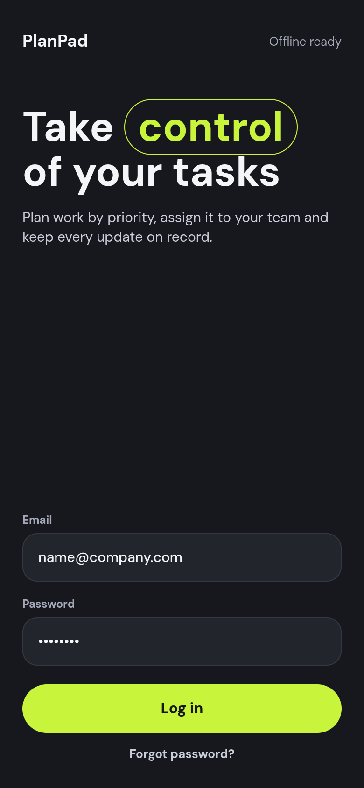
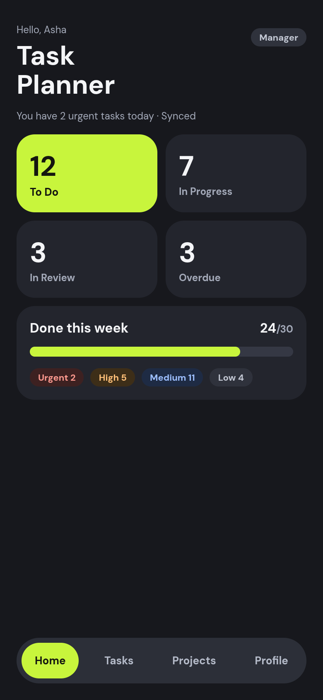
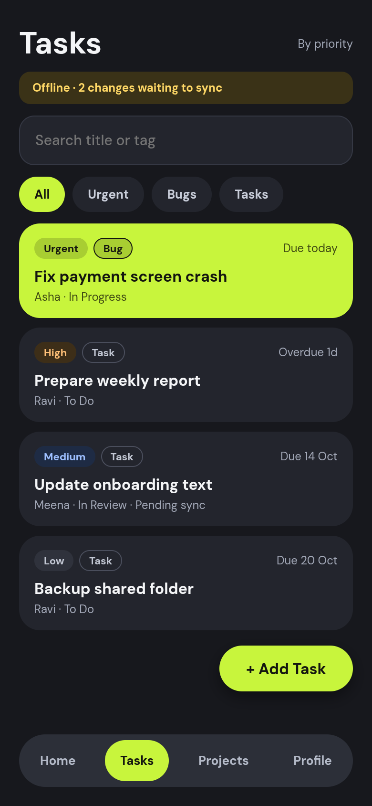
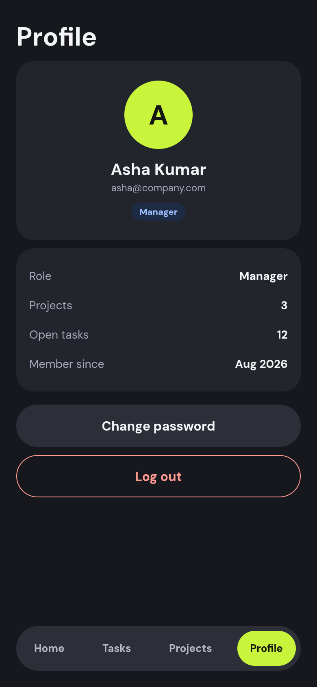

<p align="center">
  
</p>

<p align="center">
  
  
  
  
</p>

# PlanPad

PlanPad is a small task manager for teams, built with Flutter and Firebase. People have roles, work is grouped into projects, every task has a priority, and every status change is recorded with who made it. The app keeps working without internet and syncs when the connection comes back.

## Screenshots

<table align="center">
  <tr>
    <td align="center"></td>
    <td align="center"></td>
    <td align="center"></td>
    <td align="center"></td>
  </tr>
  <tr>
    <td align="center">Login</td>
    <td align="center">Home</td>
    <td align="center">Task List</td>
    <td align="center">Profile</td>
  </tr>
</table>

## Features

- Multiple users with different roles
- Projects with their own team (Manager, Dev or Test)
- Tasks and bugs with a priority: Urgent, High, Medium or Low
- Assign a task to a member of the project
- Status flow: To Do, In Progress, In Review, Blocked, Done, Cancelled
- Status history on every task: what changed, who changed it and when
- Search, filter and sort the task list
- Home dashboard with counts by status and priority
- Works offline and syncs automatically
- Profile with change password and log out

## Roles

| Role | What they can do |
|---|---|
| **Admin** | Everything, including every project and task |
| **Manager** | Create projects and tasks, manage project teams, assign work |
| **Member** | See the tasks of their projects and update the status of tasks assigned to them |

Inside a project, each person also has a project role: **Manager**, **Dev** or **Test**. That is only a label for the project. The app role above decides what they can do.

## Screens

| Screen | What it does |
|---|---|
| Login | Sign in with email and password, reset a forgotten password |
| Home | Counts by status and priority, overdue tasks, weekly progress |
| Tasks | Priority-sorted list with search, filters and sorting |
| Add Task | Choose project, assignee, type, priority and due date |
| Task Details | Task information, change status, status history |
| Projects (managers) | Each project with its team and top pending tasks |
| Project Details | Team, pending and completed tasks, manage members |
| Add Project | Name, description and team members with roles |
| Profile | Account details, change password, log out |

## How it works

Screens read from providers, providers read from repositories, and only repositories talk to Firestore.

```
Screen  →  Provider  →  Repository  →  Cloud Firestore
```

Firestore streams new data, the provider updates, and the screen rebuilds on its own.

## Tech stack

| Area | Choice |
|---|---|
| App | Flutter |
| State management | Riverpod |
| Sign-in | Firebase Authentication (email and password) |
| Database | Cloud Firestore, with offline cache |

Main packages: `firebase_core`, `firebase_auth`, `cloud_firestore`, `flutter_riverpod`, `intl`, `flutter_spinkit`.

## Project structure

```
lib/
  core/        colours, theme, validators
  models/      users, projects, tasks, status history
  providers/   app state and data streams
  services/    code that talks to Firebase
  screens/     login, home, tasks, projects, profile
  shared/      reusable widgets (modals, dialogs, snackbar)
assets/
  banner.svg
```

## Data

Firestore collections:

| Collection | Holds |
|---|---|
| `users` | Name, email, app role, active flag |
| `projects` | Name, description, team members and their project roles |
| `tasks` | Title, type, priority, status, assignee, due date |
| `tasks/{id}/statusHistory` | Each status change, who made it and when |

## Getting started

1. Install the Flutter SDK.
2. Create a Firebase project and turn on **Email/Password** sign-in.
3. Create a **Cloud Firestore** database.
4. Add the Android app to Firebase and put `google-services.json` in `android/app/`.
5. Run:

```bash
flutter pub get
flutter run
```

Firestore will ask for an index the first time a sorted list loads. The error in the debug console has a link that creates it.

Hot reload does not pick up new plugins. After adding one, stop the app, run `flutter clean`, then run it again.

## Offline

- Saved data opens with no connection, and tasks and statuses can be changed offline.
- Changes that have not reached the server show **Pending sync**.
- When the connection returns, changes upload on their own.
- The first sign-in, adding users and changing a password need internet.

## Design

A dark theme with one lime accent. Colours are in `AppColors`, and the theme is in `AppTheme`.

| Role | Colour | Hex |
|---|---|---|
| Primary |  | `#C8F53C` |
| Background |  | `#17181D` |
| Surface |  | `#23252D` |
| Text |  | `#F4F5F7` |
| Text secondary |  | `#A3A9B8` |

Priority badges: Urgent is red, High is orange, Medium is blue and Low is grey.

## Not included

- Push notifications
- Task comments. Only the status history is kept
- File attachments